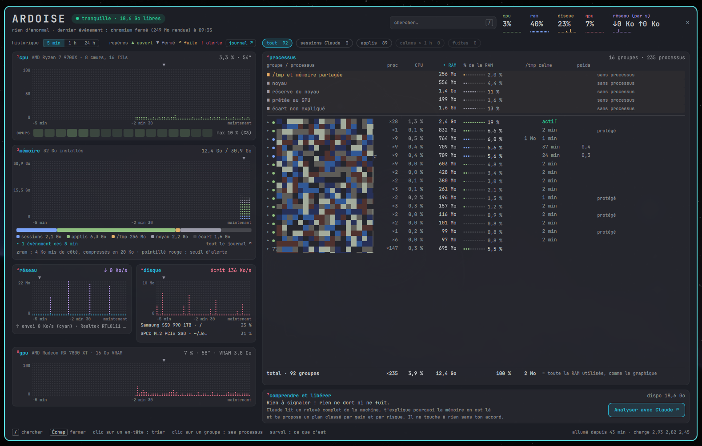

# Ardoise

An Omarchy bar widget that tells you **who** is using your machine, in rows that add up to the total.

Most monitors list processes one by one. Ardoise groups them by what you actually launched and charges each group everything it costs:

- **Claude Code sessions** with their MCP servers, their shells, their scratchpad in `/tmp` and their share of zram — one bill per session.
- **Memory owned by no process**: files in `/tmp` and `/dev/shm`, zram, kernel memory.
- **Apps**, grouped by application, and **clones** (the same MCP server running once per session).
- **The gap**: whatever the breakdown cannot explain, shown instead of hidden. The rows always add up to the RAM in use.

It also draws CPU, memory, network, disk and GPU charts (5 min, 1 h, 24 h), and lists every process grouped by app or session, with actions on hover (pause, resume, lower priority, stop, kill).

To free memory, **Analyze with Claude** opens a Claude Code conversation that reads a full report of the machine (groups, idle sessions, orphan scratchpads, a ranked list of what could be closed) and proposes a plan sorted by gain and risk. It changes nothing without your approval.

The interface follows the system language: French or English.



## Install

From the Omarchy plugin manager, or:

```bash
omarchy plugin add https://github.com/Smilecry44/ardoise.git --enable
omarchy restart shell
```

Optional, to use `ardoise` in a terminal:

```bash
ln -sf ~/.config/omarchy/plugins/io.github.smilecry44.ardoise/ardoise ~/.local/bin/ardoise
ardoise            # readable breakdown
ardoise --json     # the same, as JSON
```

## Remove

```bash
omarchy plugin remove io.github.smilecry44.ardoise
rm -f ~/.local/bin/ardoise                       # if you linked the command
rm -rf ~/.local/state/ardoise ~/.cache/ardoise   # history and description cache
omarchy restart shell
```

## Requirements

- Omarchy with the Quickshell bar, Linux `/proc`, `python3` (standard library only).
- Optional: [Claude Code](https://claude.com/claude-code) — sessions are detected from `~/.claude/sessions`, and "Analyze with Claude" opens a conversation that reads a full report and suggests what to free. Without Claude Code these parts are hidden.
- Optional: Herdr — session rows show their Herdr space, and clicking a session brings its conversation forward. Without Herdr, the analysis opens in a terminal.
- GPU chart: GPUs that expose `gpu_busy_percent` in sysfs (AMD). Other GPUs: the chart stays empty.

## Settings

In the bar entry of `~/.config/omarchy/shell.json`:

| Key | Default | |
|---|---|---|
| `language` | `auto` | `auto`, `fr` or `en` |
| `alertThreshold` | `85` | RAM % that triggers a notification naming the biggest consumers |
| `herdrSpace` | `Ardoise` | Herdr space where the analysis opens |
| `command` | bundled `ardoise` | path to another copy of the command |

## IPC

```bash
omarchy-shell io.github.smilecry44.ardoise openWindow
omarchy-shell io.github.smilecry44.ardoise analyser        # open the Claude analysis
omarchy-shell io.github.smilecry44.ardoise chercher firefox
omarchy-shell io.github.smilecry44.ardoise vue 1h          # 5min | 1h | 24h
```

## What it touches

Ardoise reads `/proc`, `/sys`, `~/.claude/sessions` and `/tmp/claude-<uid>`. It writes a 48-hour history to `~/.local/state/ardoise/` and a description cache to `~/.cache/ardoise/`. It only stops or deletes something when you click an action, and closing a Claude session keeps it resumable with `claude --resume`.

## License

MIT
