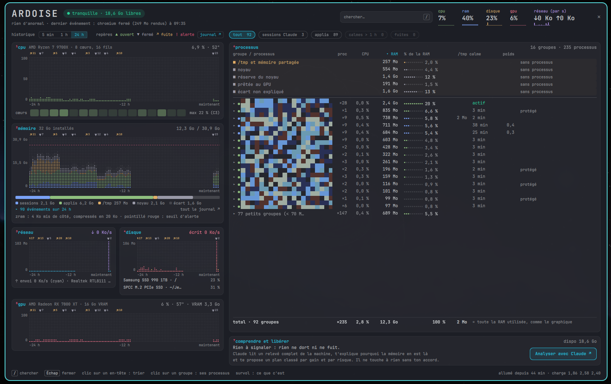
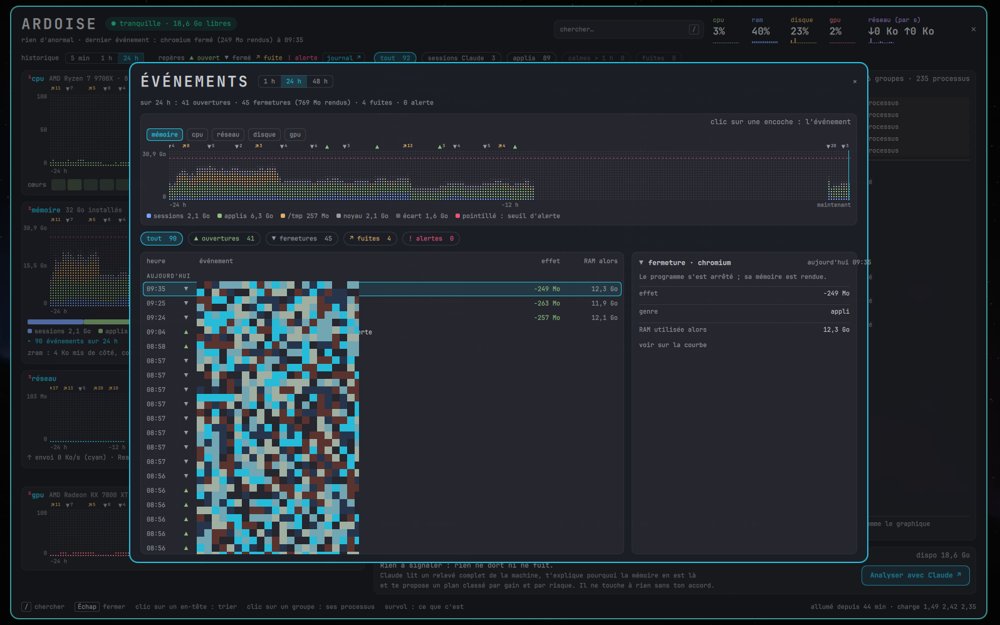
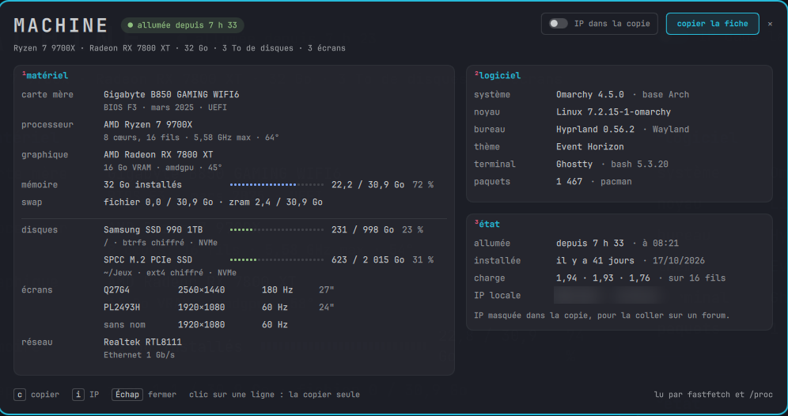

# Ardoise

An Omarchy bar widget that tells you **who** is using your machine, in rows that add up to the total.


<sub>Screenshots taken with the French interface. Claude Code session names are pixelated.</sub>

## Who uses the RAM

Most monitors list processes one by one. Ardoise groups them by what you actually launched and charges each group everything it costs:

- **Claude Code sessions** with their MCP servers, their shells, their scratchpad in `/tmp` and their share of zram — one bill per session.
- **Memory owned by no process**: files in `/tmp` and `/dev/shm`, zram, kernel memory.
- **Apps**, grouped by application, and **clones** (the same MCP server running once per session).
- **The gap**: whatever the breakdown cannot explain, shown instead of hidden. The rows always add up to the RAM in use.

Every process is listed, grouped by app or session, with actions on hover (pause, resume, lower priority, stop, kill).

To free memory, **Analyze with Claude** opens a Claude Code conversation that reads a full report of the machine (groups, idle sessions, orphan scratchpads, a ranked list of what could be closed) and proposes a plan sorted by gain and risk. It changes nothing without your approval.

## History

CPU, memory (split by owner), network, disk and GPU over 5 min, 1 h or 24 h, kept on disk for 48 h.



## Events

A session or app opening or closing, a memory leak, a RAM alert: each one is a small notch above the charts. Notches too close to read apart merge into the most important one (alert, then leak, closing, opening) followed by how many there are. A folding log sits under the memory chart; hovering a line marks that moment on every chart.

**tools ▾ → log ↗** opens the events window: 1 h, 24 h or 48 h, a strip of memory, CPU, network, disk or GPU with a notch per event, filters by kind, a list by day, and the details of each event (effect on memory, RAM in use at that moment, the curve of a leak).



## Machine card

**tools ▾ → machine ↗** shows the machine at a glance: motherboard and BIOS, processor, graphics, memory, swap, disks (with encryption), displays and network; the system, kernel, desktop, theme, terminal and packages; how long it has been up, when it was installed, the load and the local IP.

**copy the card** puts it on the clipboard as Markdown, ready to paste on Reddit, Discord or GitHub when asking for help. No serial numbers, no user name, and the local IP stays out unless you switch it on. Clicking a line copies that line alone.



The details come from [fastfetch](https://github.com/fastfetch-cli/fastfetch), shipped with Omarchy. Without it, the card shows what Ardoise reads itself from `/proc` and `/sys`.

The interface follows the system language: French or English.

## Install

From the Omarchy plugin manager, or:

```bash
omarchy plugin add https://github.com/Smilecry44/ardoise.git --enable
omarchy restart shell
```

Optional, to use `ardoise` in a terminal:

```bash
ln -sf ~/.config/omarchy/plugins/io.github.smilecry44.ardoise/ardoise ~/.local/bin/ardoise
ardoise            # readable breakdown
ardoise --json     # the same, as JSON
ardoise machine    # the machine card, as Markdown (--ip adds the local IP, --json for the raw data)
```

## Remove

```bash
omarchy plugin remove io.github.smilecry44.ardoise
rm -f ~/.local/bin/ardoise                       # if you linked the command
rm -rf ~/.local/state/ardoise ~/.cache/ardoise   # history and description cache
omarchy restart shell
```

## Requirements

- Omarchy with the Quickshell bar, Linux `/proc`, `python3` (standard library only).
- Optional: [Claude Code](https://claude.com/claude-code) — sessions are detected from `~/.claude/sessions`, and "Analyze with Claude" opens a conversation that reads a full report and suggests what to free. Without Claude Code these parts are hidden.
- Optional: Herdr — session rows show their Herdr space, and clicking a session brings its conversation forward. Without Herdr, the analysis opens in a terminal.
- Optional: `fastfetch` (installed with Omarchy) for the full machine card, and `wl-copy` to copy it.
- GPU chart: GPUs that expose `gpu_busy_percent` in sysfs (AMD). Other GPUs: the chart stays empty.

## Settings

In the bar entry of `~/.config/omarchy/shell.json`:

| Key | Default | |
|---|---|---|
| `language` | `auto` | `auto`, `fr` or `en` |
| `alertThreshold` | `85` | RAM % that triggers a notification naming the biggest consumers |
| `herdrSpace` | `Ardoise` | Herdr space where the analysis opens |
| `command` | bundled `ardoise` | path to another copy of the command |

## IPC

```bash
omarchy-shell io.github.smilecry44.ardoise openWindow
omarchy-shell io.github.smilecry44.ardoise analyser        # open the Claude analysis
omarchy-shell io.github.smilecry44.ardoise chercher firefox
omarchy-shell io.github.smilecry44.ardoise vue 1h          # 5min | 1h | 24h
omarchy-shell io.github.smilecry44.ardoise journal         # the events window
```

## What it touches

Ardoise reads `/proc`, `/sys`, `~/.claude/sessions` and `/tmp/claude-<uid>`. It writes a 48-hour history to `~/.local/state/ardoise/` and a description cache to `~/.cache/ardoise/`. It only stops or deletes something when you click an action, and closing a Claude session keeps it resumable with `claude --resume`.

## License

MIT
